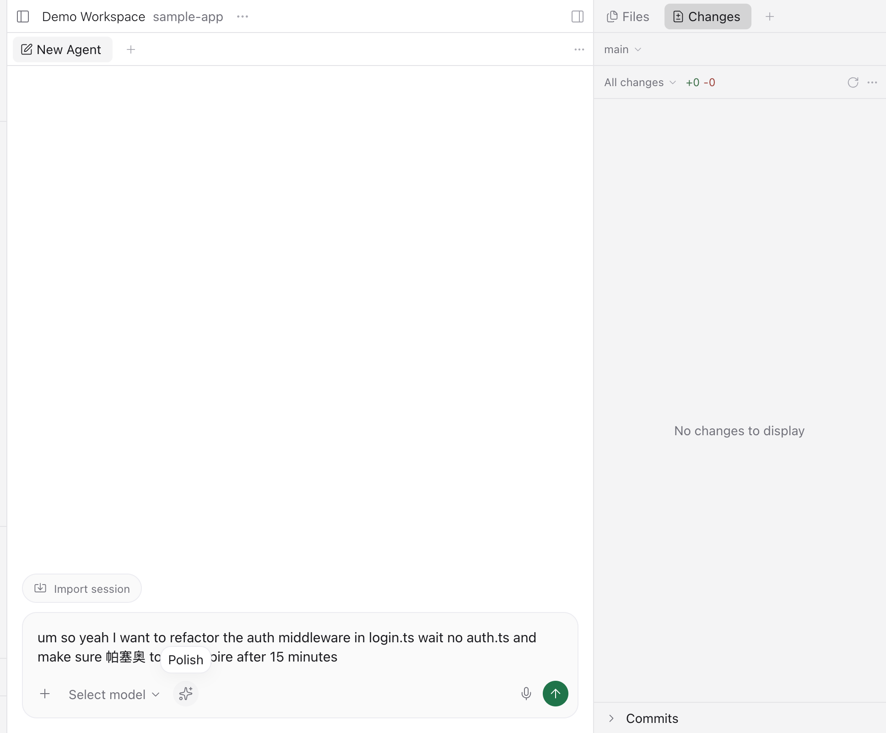
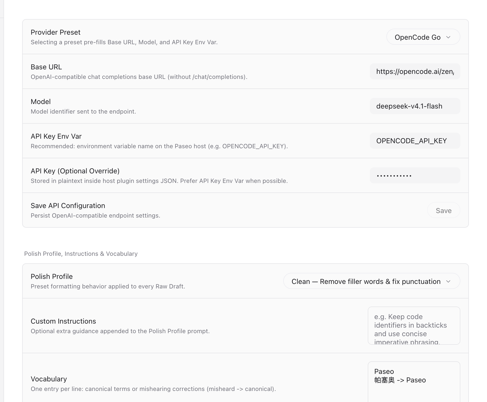
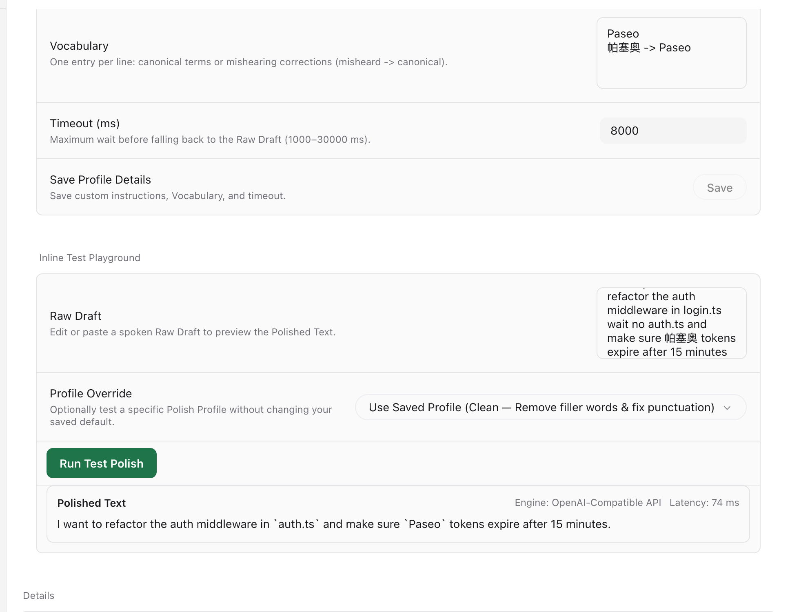

<p align="center">
  
</p>

# Dictation Polish (`paseo-dictation-polish`)

Clean up spoken dictation and rough prompt drafts right inside the [Paseo](https://paseo.sh) composer before sending them to an agent.

> Requires Paseo `>=0.17.0`.

## Features

- **One-click Composer Polish & Undo**: Click the **Polish** (`Sparkles`) button in the composer action bar to clean your draft in place. Right after polishing, the same button flips to **Undo polish** (slashed `Sparkles` icon) so you can revert to the exact original draft in one click—or use **Revert last polish** from the Command Center (`⌘K`).
- **Text-Only OpenAI-Compatible Polish Engine**:
  - Direct, tool-free `/chat/completions` (`temperature: 0`) calls with built-in presets for **OpenCode Go** (`https://opencode.ai/zen/go/v1`), **OpenAI**, **Groq**, **Ollama (Local)**, and **Custom** endpoints.
  - Resolves API keys strictly from daemon host environment variables (e.g. `OPENCODE_API_KEY`) and never stores secrets in plugin settings or exposes filesystem/MCP tools.
- **Polish Profiles & Vocabulary**:
  - `clean`: Removes verbal fillers (`um`, `uh`, `嗯`, `那个`), resolves mid-sentence self-corrections, fixes punctuation, and wraps code identifiers/paths in backticks while preserving original language and intent.
  - `structured`: Organizes multi-point spoken instructions into concise Markdown lists or steps.
  - `translate-en`: Cleans and translates Chinese or mixed Chinese/English dictation into concise English coding prompts.
  - **Vocabulary**: Host-wide canonical spellings (`Paseo`, `useComposer`) and explicit mishearing fixes (`帕塞奥 -> Paseo`).
- **Strict Fail-Open & Race Protection**: Timeouts (default `8000ms`), network errors, empty responses, runaway expansion, or concurrent typing while polishing is in flight never lose or overwrite your text.
- **Bilingual UI**: Native `en` and `zh-CN` support that follows your Paseo app language, plus an inline **Test Playground** inside Settings.

## Screenshots

### 1. Polish a spoken draft in the Composer


### 2. Instant in-place Polished Text & one-click Undo


### 3. Settings: Dual Engine, OpenCode Go Preset, Profiles & Vocabulary


### 4. Inline Test Playground


## Installation

Install from this repository or local checkout using the Paseo CLI:

```bash
paseo plugin install github:quickwind/paseo-dictation-polish
```

Or from a local directory:

```bash
paseo plugin install /absolute/path/to/paseo-dictation-polish
```

Then open **Settings → Plugins → Dictation Polish** to pick your engine, profile, and vocabulary, and verify everything in the **Inline Test Playground**.

## Development

```bash
npm install
npm run check     # typecheck + unit tests + boundary/mobile/overview audits
npm run typecheck # TypeScript typecheck only
npm test          # Vitest suite only
```

## Architecture & Docs

- [GLOSSARY.md](GLOSSARY.md) — Domain terminology
- [docs/adr/0001-manual-composer-polish-until-upstream-hook.md](docs/adr/0001-manual-composer-polish-until-upstream-hook.md) — Why v1 uses a manual Composer action (pending upstream Paseo Discussion #10523)
- [docs/adr/0002-warm-standby-async-rotate-background-agent.md](docs/adr/0002-warm-standby-async-rotate-background-agent.md) — Warm-standby + async rotate-and-kill lifecycle
- [OVERVIEW.md](OVERVIEW.md) / [OVERVIEW.zh-CN.md](OVERVIEW.zh-CN.md) — Paseo Plugin Marketplace listing pages
